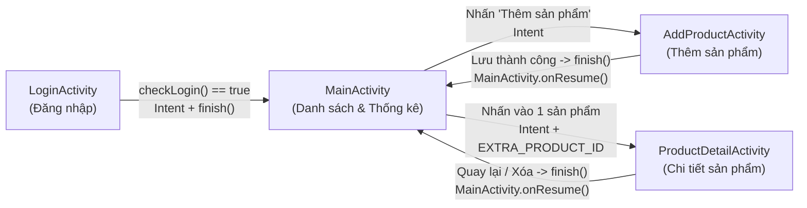

# Tài liệu giải thích quy trình hoạt động — Ứng dụng Quản lý kho hàng

## 1. Tổng quan kiến trúc ứng dụng

Ứng dụng **Quản lý kho hàng** được phát triển bằng ngôn ngữ **Java** và giao diện **XML**, sử dụng hoàn toàn cơ sở dữ liệu cục bộ **SQLite** thông qua lớp `SQLiteOpenHelper` (`warehouse.db`, phiên bản 1), không sử dụng Room, Firebase hay API ngoài.

### Cấu trúc các thành phần chính

| Thành phần | Đường dẫn | Vai trò |
| :--- | :--- | :--- |
| Model `Product` | `model/Product.java` | Biểu diễn đối tượng sản phẩm (`id`, `name`, `price`, `quantity`, `category`, `active`, `description`) và các hàm tính giá trị tồn (`getInventoryValue()`), kiểm tra sắp hết hàng (`isLowStock()`). |
| SQLite Helper `DatabaseHelper` | `database/DatabaseHelper.java` | Quản lý khởi tạo CSDL `warehouse.db`, tạo 2 bảng `users` & `products`, chèn dữ liệu mẫu và cung cấp các hàm CRUD + thống kê có tham số hóa (`?` và `selectionArgs`). |
| Adapter `ProductAdapter` | `adapter/ProductAdapter.java` | Kết nối `ArrayList<Product>` (kết quả truy vấn từ SQLite) với `RecyclerView` ở `MainActivity`, đánh dấu cảnh báo đỏ nếu `quantity < 5`. |
| Tiện ích `FormatUtils` | `util/FormatUtils.java` | Định dạng tiền tệ VNĐ có dấu phân cách hàng nghìn (ví dụ: `150.000 đ`). |
| Màn hình 1 `LoginActivity` | `LoginActivity.java` | Màn hình khởi động (`LAUNCHER`), kiểm tra đăng nhập từ bảng `users`. |
| Màn hình 2 `MainActivity` | `MainActivity.java` | Hiển thị khối thống kê kho hàng và danh sách sản phẩm từ SQLite; điều hướng sang thêm mới hoặc chi tiết. |
| Màn hình 3 `AddProductActivity` | `AddProductActivity.java` | Biểu mẫu nhập và kiểm tra tính hợp lệ của sản phẩm mới, lưu vào SQLite. |
| Màn hình 4 `ProductDetailActivity` | `ProductDetailActivity.java` | Xem chi tiết theo `id`, tăng/giảm số lượng (`Nhập thêm 1` / `Bán 1`), hoặc xóa sản phẩm khỏi SQLite. |

---

## 2. Sơ đồ luồng chuyển màn hình



---

## 3. Quy trình hoạt động chi tiết theo từng giai đoạn

### Giai đoạn 1: Khởi tạo cơ sở dữ liệu (`DatabaseHelper.onCreate`)

Khi ứng dụng được mở lần đầu tiên (tệp `warehouse.db` chưa tồn tại trên thiết bị), Android tự động gọi `DatabaseHelper.onCreate(SQLiteDatabase db)`:

1. Tạo bảng `users` gồm các cột: `id` (khóa chính tự tăng), `username` (`TEXT NOT NULL UNIQUE`), `password` (`TEXT NOT NULL`).
2. Tạo bảng `products` gồm các cột: `id` (khóa chính tự tăng), `name`, `price`, `quantity`, `category`, `active` (`1` = đang kinh doanh, `0` = ngừng kinh doanh), `description`.
3. Chèn sẵn tài khoản mặc định: `admin` / `123456`.
4. Chèn sẵn 3 sản phẩm mẫu (`active = 1`):
   - **Chuột không dây** — `150.000 đ` — `Điện tử` — Số lượng: `20`
   - **Bàn phím cơ** — `450.000 đ` — `Điện tử` — Số lượng: `3` *(cảnh báo sắp hết hàng)*
   - **Sổ tay A5** — `25.000 đ` — `Văn phòng phẩm` — Số lượng: `40`

> **Lưu ý bền vững dữ liệu:** Do toàn bộ dữ liệu được lưu trong `warehouse.db` trên bộ nhớ trong của ứng dụng, khi người dùng tắt hẳn ứng dụng rồi mở lại, `onCreate()` không chạy lại nữa và mọi thay đổi (thêm, nhập/bán, xóa) đều được giữ nguyên.

---

### Giai đoạn 2: Đăng nhập (`LoginActivity`)

1. Người dùng nhập **Tên đăng nhập** (`edtUsername`) và **Mật khẩu** (`edtPassword`, ẩn ký tự bằng `inputType="textPassword"`).
2. Khi nhấn nút **Đăng nhập** (`btnLogin`) hoặc phím Done trên bàn phím:
   - **Kiểm tra rỗng:** Nếu tên đăng nhập hoặc mật khẩu trống, hiển thị thông báo lỗi trên `tvError` và không cho đăng nhập.
   - **Truy vấn SQLite:** Gọi `databaseHelper.checkLogin(username, password)`. Phương thức này thực thi câu lệnh SQL có tham số:
     ```sql
     SELECT id FROM users WHERE username = ? AND password = ?
     ```
     và luôn đóng `Cursor` trong khối `finally`.
   - **Kết quả đúng:** Ẩn thông báo lỗi, dùng `Intent` chuyển sang `MainActivity` và gọi `finish()` để xóa `LoginActivity` khỏi Back Stack (nhấn nút Back sẽ thoát thay vì quay lại màn hình đăng nhập).
   - **Kết quả sai:** Hiển thị `"Sai tên đăng nhập hoặc mật khẩu"` trên `tvError` và giữ người dùng ở lại màn hình đăng nhập.

---

### Giai đoạn 3: Hiển thị danh sách và thống kê (`MainActivity`)

1. Khi vào `MainActivity` (và mỗi lần quay lại từ `AddProductActivity` hoặc `ProductDetailActivity`), phương thức vòng đời `onResume()` tự động gọi `loadProductsAndStatistics()`.
2. `databaseHelper.getAllProducts()` truy vấn toàn bộ bảng `products` (sắp xếp `ORDER BY id DESC` để sản phẩm mới thêm hiển thị lên đầu) và trả về `ArrayList<Product>` chỉ dùng cho mục đích hiển thị qua `ProductAdapter`.
3. Cập nhật khối thống kê từ SQLite:
   - **Tổng số sản phẩm:** số lượng phần tử truy vấn được (`products.size()`).
   - **Tổng giá trị kho:** gọi `databaseHelper.getTotalValue()` (`SELECT COALESCE(SUM(price * quantity), 0) FROM products`).
   - **Số sản phẩm sắp hết hàng:** gọi `databaseHelper.countLowStock()` (`SELECT COUNT(*) FROM products WHERE quantity < 5`).
4. Với từng dòng trong `RecyclerView` (`item_product.xml`):
   - Hiển thị tên, loại sản phẩm, giá bán (định dạng VNĐ), số lượng tồn.
   - Nếu `quantity < 5`, hiển thị nhãn cảnh báo **"Sắp hết hàng"** (hoặc **"Hết hàng"** nếu `= 0`) và đổi màu chữ số lượng sang màu đỏ.
   - Nếu `products` rỗng, ẩn `RecyclerView` và hiển thị thông báo kho trống (`tvEmptyList`).
5. Nhấn vào nút **Thêm sản phẩm** mở `AddProductActivity`; nhấn vào một dòng sản phẩm mở `ProductDetailActivity` kèm `PRODUCT_ID` qua `Intent`.

---

### Giai đoạn 4: Thêm sản phẩm mới (`AddProductActivity`)

1. Người dùng nhập: Tên sản phẩm, Giá bán (`number`), Số lượng (`number`), chọn Loại sản phẩm từ `Spinner` (`Điện tử`, `Thực phẩm`, `Văn phòng phẩm`, `Gia dụng`, `Khác`), bật/tắt `Switch` **Đang kinh doanh** (mặc định bật) và nhập Mô tả (không bắt buộc).
2. Khi nhấn **Lưu sản phẩm**:
   - Kiểm tra hợp lệ: tên không được trống; giá bán phải là số nguyên dương (`> 0`); số lượng phải là số nguyên không âm (`>= 0`). Nếu sai sẽ gọi `setError()` trên ô nhập tương ứng và hiển thị `Toast`.
   - Nếu hợp lệ, tạo đối tượng `Product` và gọi `databaseHelper.insertProduct(newProduct)` để chèn vào bảng `products`.
   - Gọi `finish()` để quay lại `MainActivity`. Tại đây `onResume()` chạy lại, tự động hiển thị sản phẩm mới và cập nhật thống kê.

---

### Giai đoạn 5: Xem chi tiết, Nhập/Bán và Xóa (`ProductDetailActivity`)

1. `ProductDetailActivity` lấy `PRODUCT_ID` từ `Intent` và gọi `databaseHelper.getProductById(productId)` để đọc dữ liệu mới nhất từ SQLite.
2. Hiển thị đầy đủ: tên, loại, trạng thái kinh doanh, giá bán, số lượng tồn, giá trị tồn kho (`price * quantity`), cảnh báo sắp hết hàng nếu `quantity < 5`, và mô tả.
3. Xử lý các nút chức năng:
   - **Nhập thêm 1:** Tăng số lượng hiện tại lên `+1`, gọi `databaseHelper.updateQuantity(productId, newQuantity)` ghi xuống SQLite và gọi `loadProductDetail()` để cập nhật ngay giá trị tồn kho và trạng thái cảnh báo trên màn hình.
   - **Bán 1:** Nếu số lượng đang bằng `0`, hiển thị `Toast("Hết hàng")` và giữ nguyên số lượng `0`. Ngược lại giảm đi `1`, ghi vào SQLite qua `updateQuantity()` và làm mới giao diện.
   - **Quay lại:** Gọi `finish()` để quay về `MainActivity`; `onResume()` của `MainActivity` sẽ đồng bộ lại danh sách và thống kê.
   - **Xóa sản phẩm:** Hiển thị hộp thoại xác nhận (`AlertDialog`); khi người dùng xác nhận xóa, gọi `databaseHelper.deleteProduct(productId)` xóa dòng dữ liệu trong SQLite và gọi `finish()` quay về `MainActivity`.
